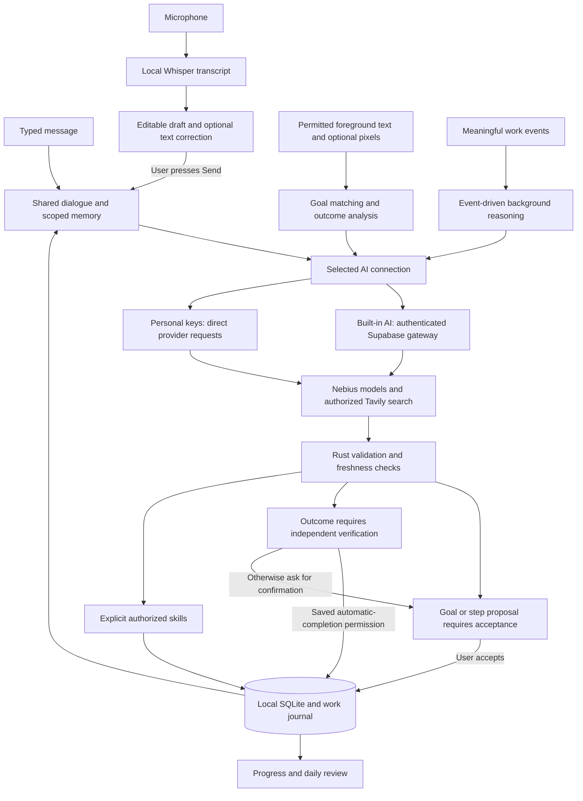

# sumi

A local-first desktop companion that helps you keep track of goals, return to unfinished work, and take the next useful step. Built with **Tauri 2, Rust, React/TypeScript and SQLite**, with cloud AI through **Nebius Token Factory** and web research through **Tavily**.

[MIT licensed](LICENSE).

## Download

**[Watch the demo and download sumi](https://artmarketvm.github.io/desktop_buddy/)** — the public landing page has the product video and Windows/macOS download buttons.

**Judges and users do not need to build sumi.** Download a ready-to-install package below, complete onboarding and use **Built-in AI**. No Node.js, Rust, account registration or personal API key is required. See the [judge installation and testing guide](docs/JUDGES_START_HERE.md).

[Get the latest release](https://github.com/ArtmarketVM/desktop_buddy/releases/latest) for the current version, release notes and verified installer assets. Replace `<version>` below with that release’s version.

| Platform | Installer                               | Support                    |
| -------- | --------------------------------------- | -------------------------- |
| Windows  | `sumi_<version>_x64-setup.exe` | Windows 10/11, x64         |
| macOS    | `sumi_<version>_aarch64.dmg`   | Apple Silicon, macOS 14.5+ |

Intel and universal Mac installers are not supported. Both platforms ship under the same release version. The application checks GitHub Releases for updates and verifies trusted updater signatures before installation.

The Mac application uses the project's stable internal code-signing identity. This is **not Apple Developer ID signing or notarization**; macOS may require approval in Privacy & Security on first launch. Updater signatures are separate from operating-system signing and do not imply Windows Authenticode certification.

## What sumi does

- **Goals, steps and Today:** create and edit goals, organize steps, reorder today's goals, and distinguish the current focus from work planned for later.
- **Chat actions:** use natural language to inspect or change goals and steps, set focus, plan Today, and ask about saved progress. Ambiguous targets require clarification; the backend validates actions before changing anything.
- **Park and Resume:** save a goal-specific checkpoint, next action and optional waiting state. Return to that context after switching goals, restarting the app or starting a new day.
- **Personal memory:** retain permitted preferences, meaningful events and work context in local SQLite. Inspect, edit, pin and forget memories in Settings. Memory and conversation history have separate controls.
- **Activity and Progress:** observe foreground app/window sessions on Windows and macOS when tracking is enabled. Attribute relevant activity to goals, distinguish idle time, and keep observed time separate from confirmed completion.
- **Gentle interventions:** offer help when work appears stuck or drifting, subject to consent, evidence, quiet schedules, context gates and duplicate prevention. Remaining silent is a valid agent decision.
- **Deadline check-ins:** show factual mascot reminders before, at and after a goal deadline. **I’m on it** acknowledges the reminder; **Reschedule** saves a future date/time; **Chat** opens a conversation. These reminders do not complete the goal or move it into Today. No macOS/Windows system notifications are used. See [deadline reminders](docs/DEADLINE_REMINDERS.md).
- **Contextual research:** after applicable search authorization, use Tavily sources to answer a current work question and attach research to the goal's WorkContext.
- **Evidence-based completion:** interpret goals against bounded interface text, recent context and optional actual pixels. A separate saved permission, enabled for new profiles, can automatically complete an existing goal/step after independent outcome verification, with durable Undo in Progress. Time alone never proves completion.
- **Work outside the plan:** offer an open Today task for ongoing work, or a completed item only for a verified result. New goals always require acceptance.
- **Optional active-window vision:** enabled for new profiles and switchable in Settings, with separate system permission, bounded encrypted review evidence, private/excluded-window gates and text fallback. Vision descriptions alone cannot close tasks.
- **Daily continuity:** summarize saved priorities, waiting items, parked work and confirmed completions across goals, without inventing completed work or assigning a productivity score.
- **Coaching:** one executable **Tiny Habits** workflow helps turn a goal barrier into a small feasible action and an anchor. It is not a collection of 16 implemented coaching workflows, and finishing a coaching micro-action does not automatically complete its parent goal.
- **Local voice input:** turn supported local speech recognition into a transcript that enters the same chat/action pipeline as typed text. Raw audio is not sent to Nebius or Tavily.

These capabilities have different prerequisites. The companion can remain visible while tracking is paused; visibility does not mean background observation or AI calls are enabled.

## AI providers and model roles

| Component                 | Default configuration                              | Role                                                                                                           |
| ------------------------- | -------------------------------------------------- | -------------------------------------------------------------------------------------------------------------- |
| Nebius Token Factory      | Hosted chat-completions API                        | Runs the configured language models; it is the inference provider                                              |
| NVIDIA Nemotron           | `nvidia/nemotron-3-super-120b-a12b`                | Background reasoning, goal matching, completion analysis and auxiliary operations                              |
| Kimi K3                   | `moonshotai/Kimi-K3`, through Nebius               | Interactive dialogue planning, action authorization/review, answers, research synthesis and checkpoint wording |
| Goal-aware foreground observation | `moonshotai/Kimi-K3` through Nebius; first-pass vision model is configurable | Combines goals, permitted interface text, recent context and optional actual pixels; independently checks observable outcomes before opt-in completion |
| Retrospective scene captioning | `nvidia/Nemotron-3.5-Super-VL` through Nebius | Bounded visual context for daily review; a caption alone is not completion evidence |
| Tavily                    | Search API                                         | Retrieves web sources; it is not a dialogue model                                                              |
| Local speech recognition | Whisper large-v3-turbo via `whisper-rs`; Metal on Apple Silicon, CPU on Windows | Converts microphone audio to an editable transcript locally; the first use downloads verified public model weights |

The language models run in the cloud. An NVIDIA GPU is not required on the user's computer. The developer panel distinguishes the **configured model** from a provider-reported model ID when one is available.

**Built-in AI** uses the server-allowed model routing. In **Use my API keys**, runtime overrides can change the personal connection: setting `NEBIUS_MODEL_ID` without `NEBIUS_REASONING_MODEL_ID` makes the interactive role use that explicitly selected primary model too. The checked-in `.env.example` includes a primary override, so copying it unchanged does **not** retain the default Nemotron/Kimi split in personal-key mode. Remove that model override or set both role overrides intentionally. Environment keys alone do not switch the app out of Built-in AI.

See [Personal AI observation](docs/PERSONAL_AI_OBSERVATION.md) for consent, evidence, journal, personalization and limits.

## How decisions become actions



See [the current architecture and decision diagrams](docs/AI_ARCHITECTURE.md) for the separate dialogue, observation, provider and presentation paths.

**The model plans; Rust owns state and executes actions.** The Skill Registry defines names, input/result schemas, validators, safety requirements and executors. Skills cover goals, steps, Today/focus, work context, research and related reads. Real goal and step IDs are supplied to planning; conversational references support follow-up requests such as “add steps there” or “delete the second one.”

For explicit chat, the bounded planning/read loop can retrieve additional information before proposing changes. A separate semantic authorization check compares writes with the user's request. Rust checks schemas, IDs, step ownership, permissions, confirmation requirements and state revisions. Stale or ambiguous proposals must not silently modify a different target. Responses are grounded in execution receipts; a failed optional response review can fall back to the backend receipt.

Background collection is frequent, but **a collector tick is not an inference request**. AgentRuntime consumes meaningful events, retrieves relevant memory and may stay silent, update permitted memory, offer help or ask for clarification. Debounce, cooldowns, cancellation, stale-response checks and event-origin filtering limit repeated calls and prevent memory-update loops. Background reasoning does not itself authorize destructive changes or a web search.

### Activity, memory and research boundaries

Goal matching uses a cascade: explicit focus, deterministic app rules, local relevance, recent WorkContext, then model assistance for stable ambiguity. Brief window switching should not trigger a new inference on every change. Progress records observed activity even when a goal cannot yet be matched, subject to tracking and privacy controls.

Memory retrieval is deterministic and scoped by actual goal, step and conversation references. It uses type, pinned status, recency and relevance within a bounded context budget; it does not send the entire SQLite database to a model. Inferred personal patterns require repeated evidence. Explicit preferences take priority over inferred ones.

Research uses the relevant goal, step and checkpoint to form a limited query. Tavily receives the query and search options rather than the full memory store. The backend validates source references and selected excerpts before attaching the synthesis. This reduces unsupported citations; it is not a guarantee that every statement is correct.

## First run and privacy

1. Install the appropriate release and complete setup. **With tracking** is preselected; continuing enables observation after the required system access is granted. Choose **Without tracking** for manual use. New profiles enable AI assistance, goal context, research, activity matching, dictation text correction, memory, screenshots and verified automatic completion; each can be disabled in Settings.
2. **Built-in AI** is selected by default: no account, invitation or API-key entry is required. To use personal provider accounts, choose **Settings → AI → Services → AI connection → Use my API keys**, then save your Nebius and Tavily keys in the existing rows.
3. Choose tracking, AI context-sharing, visible-text assistance, memory and interruption preferences. On macOS, grant the relevant Accessibility permission for supported observation features.
4. For voice, grant microphone access. The first microphone action downloads the verified multilingual Whisper model (about 548 MiB); allow it to finish before recording. OS Dictation language packs are not used by this path. Recognition quality still depends on the recording and language. See [local voice](docs/LOCAL_VOICE.md).
5. Select a focus goal and inspect Progress and the **Personal AI Engine** panel to verify actual behavior.

Tracking startup follows saved onboarding consent and the saved tracking request; it does not universally reset to paused. OS permissions and privacy gates still apply. Quiet Mode/DND, quiet hours or days, companion pause/snooze, excluded/private apps and detected meeting/away/fullscreen states can suppress background interruptions. Legacy working-hours fields are not a mascot delivery schedule; see [mascot message policy](docs/MASCOT_NOTIFICATIONS.md).

Goals, conversations, activity and memory are stored in the user's local SQLite database. The application does **not** encrypt that database itself. Foreground app names and bounded window titles can be retained as activity data. When screenshot assistance is enabled, permitted active-window images and bounded interface-text samples can be retained as encrypted local review evidence until the corresponding Daily summary is successfully saved, then deleted. A failed or missed summary can retain this evidence across restarts; clearing local history deletes it. This evidence is separate from permanent Personal Memory and the unencrypted activity database. Enabled AI features can send permitted images and bounded, filtered visible text to Nebius. See [Daily activity review](docs/DAILY_ACTIVITY_REVIEW.md) for the storage and cleanup lifecycle.

Built-in AI relays permitted requests through an authenticated Supabase Edge Function. Nebius and Tavily keys remain server-side; only the public Supabase client configuration ships in the app. A technical anonymous session starts automatically and is retained in a private local file; it cannot read service tables or retrieve provider secrets. Atomic server limits apply uniformly, with no account tiers or invitations. See [Shared AI deployment](docs/SUPABASE_GATEWAY.md).

In **Use my API keys**, provider keys remain runtime-only: Windows uses Credential Manager; macOS uses Keychain through the unchanged pinned credential helper. Saved keys take precedence over environment keys. Removing a saved key does not revoke it at the provider and can expose an existing environment fallback. Switching connections preserves saved keys and never silently falls back to a different account.

“Local-first” does not mean entirely offline: enabled cloud features send permitted text/context to Nebius and authorized search queries to Tavily. Memory OFF stops memory use/writes through its controls; it is separate from deleting chat history, goals or activity. Review the individual data controls before sharing sensitive work.

## Developer setup

Use Node.js 24, Rust stable and CMake (required by the local Whisper C/C++ dependency). Windows development also needs the MSVC toolchain, Visual Studio C++ Build Tools, a Windows SDK and WebView2. macOS development needs Apple Silicon, macOS 14.5+ and Xcode Command Line Tools.

```bash
npm ci
npm run tauri -- dev
```

`npm run dev` starts a frontend-only Vite preview. It does not establish native tracking, Keychain access, speech recognition or an end-to-end agent test.

For optional personal-provider credentials, select **Use my API keys**, then copy `.env.example` to the ignored `.env` and edit it locally; never commit credentials or put them in frontend variables. See the model-override note above before copying its defaults. Packaged builds also accept process environment overrides.

### Runtime configuration

| Variable                    | Meaning                                                                                           |
| --------------------------- | ------------------------------------------------------------------------------------------------- |
| `NEBIUS_API_KEY`            | Runtime Nebius key, used when no saved key takes precedence                                       |
| `NEBIUS_API_URL`            | Full chat-completions endpoint; default `https://api.tokenfactory.nebius.com/v1/chat/completions` |
| `NEBIUS_MODEL_ID`           | Optional primary model override; also used for interactive responses unless separately overridden |
| `NEBIUS_REASONING_MODEL_ID` | Optional interactive response/planning model override; the variable retains its historical name   |
| `TAVILY_API_KEY`            | Runtime Tavily key, used when no saved key takes precedence                                       |
| `TAVILY_API_URL`            | Search endpoint; default `https://api.tavily.com/search`                                          |
| `DEMO_MODE`                 | `true` simulates activity; it does not enable mock provider responses                             |
| `AI_MOCK`                   | `true` explicitly enables mock AI responses; leave off for real-provider testing                  |

Both demo flags default to false. A simulated activity run with real HTTP calls is still not evidence of native foreground tracking.

### Local builds and releases

On Windows, `./scripts/dev.ps1 -Task build` creates a separate personal development installer. Official release builds additionally require the existing trusted updater signing credentials.

On macOS, use the reviewed internal identity in `src-tauri/macos-code-signing.json` and the signing preparation in `scripts/internal-macos-signing.sh`. **An ad-hoc signed build cannot read the saved provider keys through the credential helper.** Do not regenerate a new certificate for each developer or build. The full release packaging command `npm run build:macos` requires the internal identity and the existing macOS updater signing key; it produces Apple Silicon artifacts only. A local signed `.app` can be prepared separately with the internal identity without publishing updater artifacts.

Startup updating is mandatory. A local candidate older than the latest published release can replace itself on launch; use a newer synchronized version while testing a candidate. Never replace a delivered installer with changed code under the same version.

The [release workflow](.github/workflows/release.yml) is launched explicitly with `workflow_dispatch` from `main`; pushing a version tag alone does not launch it. It validates the synchronized version, tests/builds both platforms, verifies release artifacts and publishes one release only after both platform jobs succeed. Preserve updater trust and app-signing identity independently.

## Verification and demo evidence

```bash
npm test
npm run build
cargo test --locked --manifest-path src-tauri/Cargo.toml
cargo fmt --manifest-path src-tauri/Cargo.toml --check
npm run test:release
npm run test:acceptance:runner
```

Unit/integration tests include mocked HTTP calls and do not require live provider keys. Use the acceptance runner's documented prerequisites when selecting native or real-provider checks. A green provider indicator or successful authentication test does not prove that a complete user workflow succeeded. The separate inference health check performs a minimal structured generation and reports latency/errors.

The [hackathon demo runbook](docs/HACKATHON_DEMO_RUNBOOK.md) documents `--check-hero`, the real-provider backend rehearsal, and a separate manual native checklist. The backend rehearsal uses synthetic workspaces and can incur provider charges. Its transcript fixture is not a microphone test; programmatic consent is not evidence of a native button click; database reopen is not a full process-restart test.

The [release workflow](.github/workflows/release.yml) runs frontend tests/build, locked Rust tests on both supported systems and release safeguards before publishing both signed update channels. [Quality gates](docs/QUALITY_GATES.md) describe strict Windows browser comparisons against owner-reviewed baselines and the blocking zero-budget lint gates and their historical rollout. Keep physical microphone, actual foreground tracking, displayed interventions and full restart acceptance separate from mocked/backend evidence.

For current CI, validation reuse and publishing commands, see [the release process](docs/RELEASE_PROCESS.md). New development sessions should begin with [the short handoff](docs/SESSION_HANDOFF.md).

## Documentation

Use the [documentation index](docs/README.md) to distinguish current guides, implementation plans and historical milestone reports. The [architecture overview](docs/AI_ARCHITECTURE.md) describes the current code paths; release notes describe their own delivered versions.

## Architecture entry points

| Area                            | Primary source                                                                                                                                                                                        |
| ------------------------------- | ----------------------------------------------------------------------------------------------------------------------------------------------------------------------------------------------------- |
| Chat and structured dialogue    | [ai_chat.rs](src-tauri/src/ai_chat.rs), [agent_dialogue.rs](src-tauri/src/agent_dialogue.rs), [dialogue_context.rs](src-tauri/src/dialogue_context.rs)                                                |
| Event-driven agent              | [agent_runtime.rs](src-tauri/src/agent_runtime.rs), [runtime modules](src-tauri/src/agent_runtime)                                                                                                    |
| Validated actions               | [skills.rs](src-tauri/src/skills.rs), [skill extensions](src-tauri/src/skills/enhancements.rs)                                                                                                        |
| Provider calls and routing      | [http.rs](src-tauri/src/http.rs), [goal_analysis.rs](src-tauri/src/goal_analysis.rs)                                                                                                                  |
| Memory and continuity           | [memory modules](src-tauri/src/memory), [work_context.rs](src-tauri/src/work_context.rs), [continuity.rs](src-tauri/src/continuity.rs)                                                                |
| Native activity and focus       | [collector adapters](src-tauri/src/collector), [window_history.rs](src-tauri/src/window_history.rs), [goal_matching.rs](src-tauri/src/goal_matching.rs), [work_state.rs](src-tauri/src/work_state.rs) |
| Companion and overdue check-ins | [companion modules](src-tauri/src/companion), [deadlines.rs](src-tauri/src/companion/deadlines.rs)                                                                                                    |
| Research and source validation  | [research.rs](src-tauri/src/research.rs), [research_evidence.rs](src-tauri/src/research_evidence.rs)                                                                                                  |
| Coaching strategies             | [coaching modules](src-tauri/src/coaching), [strategy registry](src-tauri/src/coaching/strategy.rs)                                                                                                   |
| Built-in AI gateway             | [shared_ai.rs](src-tauri/src/shared_ai.rs), [Supabase function](server/supabase/functions/buddy-ai/handler.ts) |
| Local voice                     | [local_voice.rs](src-tauri/src/local_voice.rs), [voice_cleanup.rs](src-tauri/src/voice_cleanup.rs) |
| Credential access               | [credentials.rs](src-tauri/src/credentials.rs), [native helper](src-tauri/native/credential-helper)                                                                                                   |

## Scope and limitations

sumi is a bounded assistant with validated application skills, not an unrestricted desktop automation agent. Model authorization/review and source validation reduce errors but cannot guarantee human intent or factual correctness. Local speech recognition requires downloaded Whisper weights, microphone permission and sufficient hardware resources; recording quality affects recognition. Background interventions require the application to be running and all applicable gates to allow them.

Google/Apple Calendar integration, arbitrary application control and a vector database are not implemented. There is no model fine-tuning: personalization comes from permitted local memory, explicit preferences and feedback. The project does not promise ChatGPT-equivalent quality or completely autonomous completion of work.

See [CHANGELOG.md](CHANGELOG.md) for version history and the [demo runbook](docs/HACKATHON_DEMO_RUNBOOK.md) for current acceptance steps. Older version-specific documents in `docs/` are historical design/validation records and can contain superseded behavior; use current source and release evidence when checking a claim.

## License

sumi is available under the [MIT License](LICENSE), copyright 2026 ArtmarketVM and sumi contributors.

Third-party components retain their own licenses. See [third-party notices](THIRD_PARTY_NOTICES.md) and the bundled [Instrument Sans](docs/fonts/instrument-sans-LICENSE.txt) and [Silkscreen](docs/fonts/silkscreen-LICENSE.txt) font licenses. The project license does not replace the terms of external AI services or model licenses.
