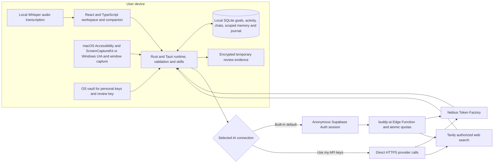
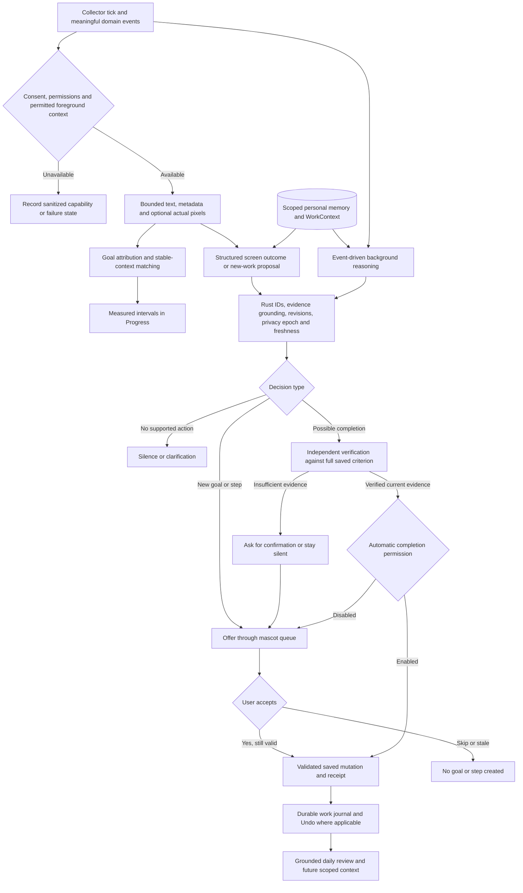

# Current AI architecture

Source audit: 29 October 2026, app 0.49.4, baseline `54fa6074337982bf898b79937a0a5cebb3c7cd35`. This is a code-grounded architecture reference, not a new live-agent accuracy report. Later environment/model overrides and server policy can affect runtime availability.

## Components and trust boundaries

Built-in provider keys never enter the frontend or the public bundle. They remain in the Edge Function environment; only public Supabase client configuration ships. Personal keys entered in Settings pass to the backend for secure storage; provider calls read the OS vault or runtime environment. The unchanged macOS credential helper accepts only the pinned signed parent. Switching modes invalidates old health receipts/pending authority and does not silently use another account after failure.

Local-first is a storage/ownership boundary, not an offline-AI claim. SQLite itself is not application-encrypted. Permitted image/interface review samples have a separate encrypted lifecycle until the corresponding Daily summary is successfully saved; missed/failed reviews can retain evidence across restart. Gateway counters and anonymous Auth sessions are separate from user goals/history. See [gateway](SUPABASE_GATEWAY.md), [review storage](DAILY_ACTIVITY_REVIEW.md) and [privacy policy](privacy.html).

## Model roles

| Role | Default | Source boundary |
| --- | --- | --- |
| General background reasoning, matching and primary auxiliary operations | `nvidia/nemotron-3-super-120b-a12b` through Nebius | `http.rs`, `goal_analysis.rs`, `goal_matching.rs`, `agent_runtime/reasoning.rs` |
| Dialogue planning, action authorization/review, answers and contextual research synthesis | `moonshotai/Kimi-K3` through Nebius | `http.rs`, `agent_dialogue.rs`, `ai_chat.rs`, research modules |
| Goal-aware screen interpretation | Kimi K3; first pass can use the configured allowed vision model | `semantic_observation.rs`, `vision.rs` |
| Independent outcome verifier | Kimi K3 by default; personal runtime override where permitted | `semantic_observation.rs` |
| Retrospective image descriptions | `nvidia/Nemotron-3.5-Super-VL` through Nebius | `vision.rs`, activity review |
| Local microphone transcription | Quantized Whisper large-v3-turbo, `whisper-rs` 0.16.0 | `local_voice.rs`, `core_import.rs` |
| Source retrieval | Tavily search API, not a dialogue model | `research.rs`, `research_evidence.rs` |

A configured or listed model is not proof of successful generation. The server has a fixed allowlist; Built-in AI keeps its routed defaults. Personal-provider model/endpoint overrides have their own rules. A bounded interactive proposal fallback can use Nemotron after a stalled default Kimi attempt; it does not replay an already executed action. See the README configuration table and `http.rs`.

Whisper downloads verified public weights on first use (about 548 MiB). Metal accelerates the Mac path; Windows uses CPU. Audio stays in memory. Optional transcript correction may send bounded text and permitted goal titles before the editable draft appears; only Send enters chat. OS Dictation/Apple Speech language packs do not drive this path. [Voice details](LOCAL_VOICE.md).

## Agent cycle and authority

These are coordinated paths, not a single model watching a continuous video. `AgentRuntime::tick` dispatches collection, domain events, matching, semantic observation/unlisted-work specialists and due activity review. Specialists retain their gates; a shared provider lock/budget bounds background work. Explicit dialogue uses its planning/read loop, independent authorization and Skill Registry executors. The model proposes; Rust owns state.

A foreground window is necessary but not sufficient. Capture can fail, text can be unavailable, relevant evidence can disappear between samples, an inference can time out, and a stale result must be rejected. Current source permits at most one capture attempt per 20 seconds and a rolling 120 background disclosures/hour, reserving headroom for independent verification. It is not a promise of a suggestion within 20 or 30 seconds. Read [observation details](PERSONAL_AI_OBSERVATION.md) for the exact catalog/evidence limits.

New tasks and steps require acceptance. Automatic completion concerns existing saved targets only, after an independent outcome check, current authority and the saved permission. New profiles enable screenshots, screen-task assistance and verified automatic completion; saved opt-outs and OS access remain authoritative. An app name, elapsed time, draft or generated scene caption alone cannot establish completion. Arbitrary offline/global goals are not guaranteed to have an observable success criterion.

## Presentation is separate from understanding

All proactive notifications are sumi character cards, never native OS notification banners. Quiet mode/hours/days, detected calls/away/fullscreen, pause/snooze and a floating chat can prevent a card from appearing. Quiet mode can silence presentation while permitted activity accounting continues. Legacy working-hours fields are not a delivery schedule. There is no former generic three-prompts-per-day presentation cap; duplicate prevention, evidence conditions and provider budgets remain.

Deadline reminders are local scheduled logic with **I’m on it / Reschedule / Chat**. They do not complete goals. Stretch reminders use active-work timing. Daily planning and summaries use their saved schedules. These can be useful without proving an AI inference occurred. [Mascot policy](MASCOT_NOTIFICATIONS.md), [deadlines](DEADLINE_REMINDERS.md).

## Scope and validation

Only Tiny Habits is registered as an executable coaching strategy; earlier descriptions of 16 methodologies were research/planning, not 16 live workflows. Calendar integration, arbitrary desktop control, meeting transcription, a vector database and model fine-tuning are not implemented. Context is permitted scoped local memory, not a model trained on the user's activity.

Unit/mock checks establish their fixture behavior. A provider health probe establishes authentication/model access. Live synthetic backend checks establish the exercised model path. Native manual checks establish only the observed build/platform/scenario. None alone proves universal goal understanding. Use [the demo runbook](HACKATHON_DEMO_RUNBOOK.md) and preserve failed/silent stages honestly.

## Source map

| Responsibility | Source |
| --- | --- |
| Event dispatch and specialist scheduling | [agent_runtime.rs](../src-tauri/src/agent_runtime.rs) and [runtime modules](../src-tauri/src/agent_runtime) |
| Dialogue and validated app skills | [agent_dialogue.rs](../src-tauri/src/agent_dialogue.rs), [skills.rs](../src-tauri/src/skills.rs) |
| Goal attribution | [goal_matching.rs](../src-tauri/src/goal_matching.rs), [work_state.rs](../src-tauri/src/work_state.rs) |
| Goal-aware outcomes | [semantic_observation.rs](../src-tauri/src/semantic_observation.rs) |
| Capture diagnostics and adapters | [vision.rs](../src-tauri/src/vision.rs), [Windows adapter](../src-tauri/src/vision/windows.rs), [macOS bridge](../src-tauri/native/macos.m) |
| Memory and checkpoints | [memory](../src-tauri/src/memory), [work_context.rs](../src-tauri/src/work_context.rs), [continuity.rs](../src-tauri/src/continuity.rs) |
| Built-in provider boundary | [shared_ai.rs](../src-tauri/src/shared_ai.rs), [gateway handler](../server/supabase/functions/buddy-ai/handler.ts) |
| Local voice and correction | [local_voice.rs](../src-tauri/src/local_voice.rs), [voice_cleanup.rs](../src-tauri/src/voice_cleanup.rs) |
| Mascot and deadlines | [companion](../src-tauri/src/companion), [InterventionCard](../src/companion/InterventionCard.tsx) |
