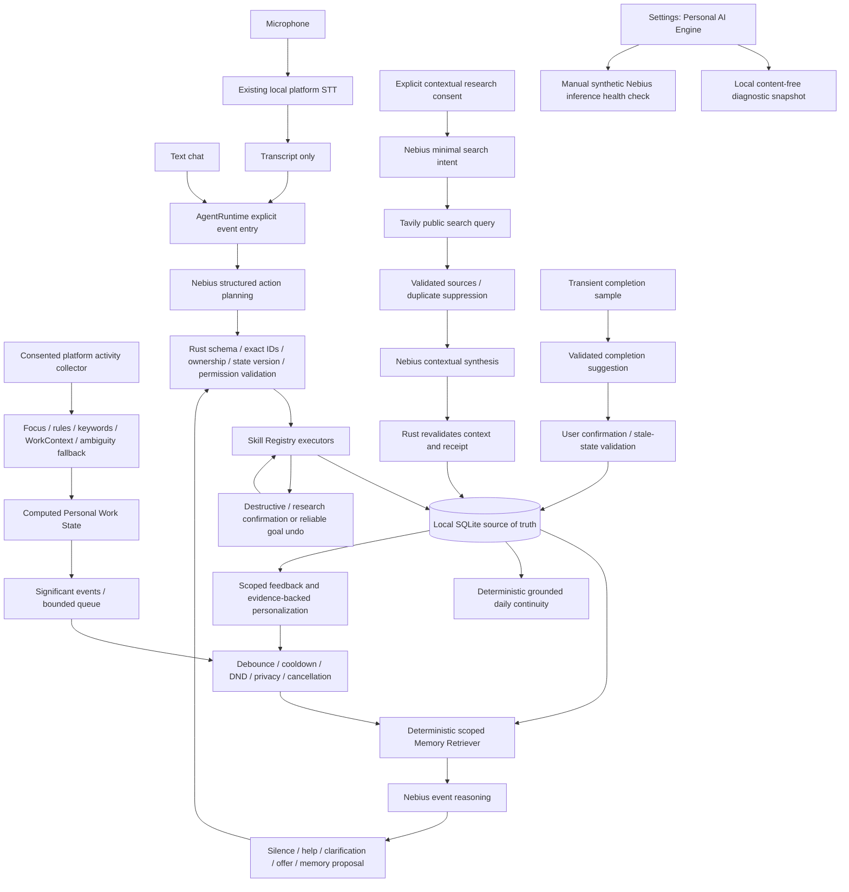

# Personal AI: Phase 10 hardening and acceptance report

Date: 2026-10-13. Baseline: `de2c00c`. Branch: `codex/event-driven-agent-runtime`.

This is a source-code milestone, not a published installer update. The application version remains 0.26.1. No release, tag, push, installation, signing-key change or provider-key change was performed. Every change uses shared React/Rust code for Windows and macOS. Native Windows verification remains a release prerequisite.

## 1. Architecture map



`AgentRuntime` is the event boundary and background coordinator, not a replacement for every pre-existing specialist. Matching, completion detection and legacy goal analysis retain their own consent and scheduling gates. Explicit text and voice transcripts enter `handle_explicit_actions`; the model plans, Rust executes. Memory learning changes local context and offer policy; it does not fine-tune Nemotron.

## 2. Components delivered across Phases 1–10

| Phase | Commit | Components |
| --- | --- | --- |
| 1 | `8e68da0` | Structured Skill Registry, exact goal/step IDs, validated executor, action state version, conversational references, confirmation and undo integration |
| 2 | `f364896` | SQLite personal/episodic memory, work contexts, scoped CRUD, evidence rules, safe migrations |
| 3 | `32d677b` | Deterministic retrieval, context budgets and selection metadata, Memory Settings, inspect/edit/forget/pin/clear controls |
| 4 | `8f483b0` | Persistent Park/Remember/Resume, separate goal checkpoints, checkpoint UI and structured workflow skills |
| 5 | `524079f` | Event-driven AgentRuntime, unified reasoning decisions, debounce/cooldown, cancellation and loop prevention |
| 6 | `5b89240` | Local STT transcripts routed into the shared text action pipeline; deletion transcript confirmation |
| 7 | `534bf65` | Cascaded goal matching, computed work state, stable-context debounce and six-lane switching benchmark |
| 8 | `4e1ad7b` | Consent-bound contextual research, Nemotron → Tavily → Nemotron, source validation/deduplication, WorkContext attachment and feedback |
| 9 | `de2c00c` | Grounded daily continuity, historical checkpoint capture, completion provenance, scoped feedback policy and conservative memory maintenance |
| 10 | This milestone | Personal AI Engine Settings panel, manual strict-schema inference probe, content-free inference instrumentation, two-lane hero regression and idle stress regression |

All previous nine phases were present as separate commits before Phase 10 started. No Phase 11 was started.

### Phase 10 file changes

| File | Responsibility |
| --- | --- |
| `src/ai/PersonalAiEngine.tsx`, `engineApi.ts`, `engine.css` | Collapsed Settings diagnostics, local manual refresh, configured/provider-reported model distinction, manual health check, seven skill categories |
| `src/ai/PersonalAiEngine.test.tsx` | Five UI regressions: no automatic inference, manual single request, honest model labels, failure redaction, absent focus/memory |
| `src/core/Settings.tsx` | Places the panel under Integrations / AI, within the shared layout |
| `src-tauri/src/engine_observability.rs` | Runtime-only telemetry, worker IPC commands, one-shot synthetic probe, timeout/size limit/sanitized failures/single-flight/cooldown |
| `src-tauri/src/engine_observability/tests.rs` | Eight diagnostics and health-check tests, including HTTP fixture integration |
| `src-tauri/src/engine_observability/hero_tests.rs` | Full synthetic two-lane planner/skills/checkpoint/research/summary/database-reopen scenario |
| `src-tauri/src/commands.rs`, `lib.rs` | In-memory telemetry ownership and IPC registration |
| `src-tauri/src/agent_runtime.rs`, `ai_chat.rs`, `research.rs`, `work_context.rs` | Instrument existing validated provider requests; record decisions and successfully executed skills, including read-only skills |
| `src-tauri/src/agent_runtime/tests.rs` | Existing cancellation test adapted to instrumentation; new 1,000-observation idle stress test |
| `src-tauri/src/companion/mod.rs` | Makes the existing completion-confirmation helper crate-visible for the integration fixture; confirmation behavior unchanged |
| `src-tauri/src/threading_tests.rs` | Includes both new commands in the existing worker-dispatch regression guard |
| `docs/HACKATHON_PHASE_10_REPORT.md` | Architecture, evidence, acceptance limits and demo runbook |

### Observability semantics

- **Configured model** comes from configuration, defaulting to `nvidia/nemotron-3-super-120b-a12b`. It is never presented as independently verified runtime identity.
- **Provider-reported model** is optional sanitized API response metadata. It is neither inferred from configuration nor proof of the provider's underlying execution.
- Last inference measures instrumented agent reasoning, structured planning/results, ordinary chat replies, checkpoints and contextual research. It includes their existing retries. Other specialist provider calls are not comprehensively instrumented.
- Runtime counters cover background AgentRuntime reasoning, not all provider traffic or billing. `Last skill` includes successful read operations as well as mutations; confirmation previews are not executions.
- Memory diagnostics show only counts and context bytes, not memory contents, IDs/reasons from the debug payload or a prompt dump. Detailed memory inspection remains a separate Memory Settings feature.
- Tavily distinguishes disabled, key missing, key configured but search untested, and the latest current-goal research job status. It is not a continuous provider health monitor.
- Refresh is local, on opening the collapsed panel or pressing Refresh. There is no polling or inference on mount.
- Telemetry is process-local and resets after restart. Old inference/health data is hidden after the privacy/configuration revision changes.
- Manual health sends one synthetic request, strict `{ok:true}` JSON Schema, 256-token cap, 16 KiB response cap, 10-second timeout, no retries, single-flight and 60-second attempt cooldown. It sends no goal, memory, audio or window data. It does not persist the request or provider response body. Its diagnostic API permits only the main window.

## 3. Verification results and complete suite inventory

Environment: Apple Silicon, macOS 27.0.1, macOS SDK 27.0. Native release binary is arm64 with Mach-O `minos 14.5` and SDK 27.0. This verifies the deployment target; it does not replace runtime testing on a physical macOS 14.5 machine.

| Command / check | Result |
| --- | --- |
| `npm test` | **133 passed**, 23 files; zero failures/skips |
| `npm run build` | Passed: synchronized-version check, TypeScript project build and Vite production bundle |
| `cargo test --locked --manifest-path src-tauri/Cargo.toml` | **392 passed**, zero failed, two existing opt-in tests ignored; explicit `backend` integration target |
| `cargo clippy --locked --manifest-path src-tauri/Cargo.toml --all-targets` | Passed with existing-code warnings; not a warning-free lint claim |
| `cargo fmt --manifest-path src-tauri/Cargo.toml --check` | Passed |
| `npx prettier --check` on the four new frontend files | Passed |
| `git diff --check` | Passed |
| `MACOSX_DEPLOYMENT_TARGET=14.5 cargo build --locked --release --manifest-path src-tauri/Cargo.toml --features custom-protocol` | Passed, optimized native Apple Silicon binary with embedded production frontend |
| `npm run test:release` | **13 passed**, zero failed/skipped; signing trust, compatibility bridge, manifests, retained Windows channel and macOS updater checks |
| `npm run test:contact` | **8 passed**, zero failed/skipped |
| Version synchronization | Passed; package/package-lock/Cargo/Cargo-lock/Tauri remain 0.26.1 |
| Windows native tests/build | Not run: no Windows SDK/runtime on this host; no Windows installer or complete dual-platform update claimed |

Frontend has no separate ESLint configuration/script. TypeScript is checked by the required production build; changed frontend files are checked by Prettier. Clippy was initially absent and was installed into the ignored checkout-local toolchain. It reports 52 library warnings and 47 test-target warnings (overlapping counts, mostly existing unused code/style issues); no warning-free claim is made.

Frontend suites (all passed):

- `src/ai/PersonalAiEngine.test.tsx`
- `src/api/platform.test.ts`, `src/api/tauri.test.ts`
- `src/companion/Compact.test.tsx`, `Companion.test.tsx`, `Conversation.runtime.test.tsx`, `Conversation.windows-voice.test.tsx`, `Markdown.test.tsx`
- `src/components/ActivityInsights.test.tsx`, `DesktopBuddy.test.tsx`, `GoalPlanner.test.tsx`, `MemorySettings.test.tsx`, `Onboarding.test.tsx`, `PrivacySettings.test.tsx`, `RecommendationHistory.test.tsx`, `TrackingSettings.test.tsx`, `sidebar.test.tsx`
- `src/core/Core.test.tsx`, `Developer2.test.tsx`, `GoalWorkContext.test.tsx`, `TrackingStatus.test.tsx`
- `src/data/roleLoop.test.ts`, `src/updates/controller.test.ts`

Rust suites, including existing provider/mock integration tests:

| Module | Passed | Ignored |
| --- | ---: | ---: |
| agent_runtime | 21 | 0 |
| ai_chat | 41 | 1 |
| attention | 2 | 0 |
| automatic_goals | 4 | 0 |
| autostart | 1 | 0 |
| browser | 1 | 0 |
| buddy | 7 | 0 |
| collector | 3 | 0 |
| commands | 5 | 0 |
| companion | 14 | 0 |
| contact | 4 | 0 |
| continuity | 20 | 0 |
| core | 16 | 0 |
| core_capture | 2 | 0 |
| core_import | 5 | 0 |
| credentials | 2 | 0 |
| engine_observability | 9 | 0 |
| goal_analysis | 9 | 0 |
| goal_matching | 21 | 0 |
| goals | 9 | 0 |
| http | 2 | 0 |
| insights | 8 | 0 |
| installed_apps | 2 | 0 |
| macos | 2 | 1 |
| macos_speech | 2 | 0 |
| memory | 51 | 0 |
| nebius | 11 | 0 |
| privacy | 6 | 0 |
| profile | 9 | 0 |
| recommendations | 4 | 0 |
| relevance | 7 | 0 |
| research | 21 | 0 |
| signing_trust | 3 | 0 |
| skills | 28 | 0 |
| startup | 1 | 0 |
| storage | 2 | 0 |
| tavily | 4 | 0 |
| threading_tests | 2 | 0 |
| tracking | 13 | 0 |
| updates | 2 | 0 |
| work_context | 16 | 0 |
| **Total** | **392** | **2** |

The threading suite includes one intentional `should_panic` guard test. The `main` and doc-test targets have zero tests and pass. New Phase 10 coverage totals ten Rust tests (eight observability tests, one hero integration, one idle stress) and five frontend tests.

### New backend regressions (all passed)

- `manual_health_is_one_real_bounded_schema_request_without_user_context`
- `health_rejects_malformed_json_schema_refusal_and_truncation`
- `health_sanitizes_http_errors_and_never_retries`
- `health_handles_timeout_invalid_envelope_and_size_limit`
- `health_single_flight_cooldown_cancellation_and_window_boundary`
- `diagnostics_are_read_only_redacted_and_hide_stale_or_disabled_memory`
- `request_cancellation_newest_request_and_privacy_staleness_are_observable`
- `instrumented_request_uses_existing_validation_and_records_metadata_only`
- `hackathon_hero_two_lanes_voice_park_receipt_resume_research_summary_restart`
- `hackathon_idle_stress_has_no_db_writes_inference_or_queue_growth`

## 4. Failed, repaired and skipped checks

No mandatory check remains failing.

Issues found and fixed before the final successful run:

- Instrumentation initially needed reference borrows for owned `Service`/Tauri `State`, a bound mutex guard, and adaptation of the existing cancellation test.
- Hero regression found that persisted conversation references retain the last mutation rather than every read skill. Phase 10 now separately records successful read and write skills in transient telemetry, so `inspect_continuity` is correctly shown as the last skill.
- The first full regression rejected the new IPC module as unchecked. Both commands are now covered by the existing asynchronous worker-dispatch source guard.
- Clippy was unavailable initially; the local toolchain component was installed and the final command passed.

Existing ignored tests:

1. `ai_chat::tests::live_ai_goal_and_chat_smoke`: paid Nebius/Tavily smoke with synthetic data; not run. Both credentials were not available in the test environment. Automated tests never read the user's OS credential vault.
2. `macos::tests::keychain_round_trip`: opt-in isolated Keychain write; not run to avoid modifying the user's credential store.

Real microphone/STT interaction, Accessibility sampling, live provider schema compatibility/latency, GUI idle CPU, native Windows execution, signing/notarization and updater installation/restart remain manual/environment-dependent checks, not automated passes.

## 5. Failure, privacy and performance review

| Case | Evidence / behavior |
| --- | --- |
| Nebius unavailable / auth / billing / rate limit | Health fixture maps HTTP failures to fixed safe statuses, performs one request and no retry; existing HTTP/provider suites verify bounded retries elsewhere |
| Malformed JSON / schema / truncation / refusal | Probe rejects all; structured planner and research parsing/validation regressions pass |
| Timeout | Probe covers send/read/parse with 10-second bound; short-delay fixture exercises timeout without waiting 10 seconds |
| Tavily unavailable | Existing research integration rejects/marks failed; no fabricated research is attached |
| Missing permissions / tracking unavailable | Existing collector, privacy and runtime tests suppress background work; physical OS permission dialog remains manual |
| No active goal / ambiguous goal | Existing exact-scope/clarification tests pass; diagnostics report missing focus rather than inventing progress |
| Memory OFF / individual toggles | Retrieval and writes respect controls; Park/Resume and continuity report the required permission; goals/history remain separate |
| DND / excluded or private application | Existing runtime and collector tests suppress unsolicited work/collection as appropriate; DND does not block a deliberately requested chat action or synthetic health check |
| Stale response / explicit input preemption | Snapshot/privacy guards and cancellation tests pass; stale network outcomes cannot commit mutations/research |
| Restart during research | Authorized/running jobs become failed on database reopen, preventing automatic network replay; a new consent/request is required |
| Duplicate research / feedback loops | Resource keys/source validation and scoped feedback tests pass; runtime-origin events cannot create unbounded self-triggered reasoning |
| Diagnostics privacy | Only whitelisted numeric/enum/model/action metadata; no API keys, prompt body, raw AX contents or retrieval content; main-window guard, redaction and read-only SQL-change test pass |

Persistent memory stays in local SQLite. This is not encryption at rest. API keys remain in the existing OS credential store/runtime configuration and are neither embedded in the frontend nor written by this phase into SQLite, source or logs. Raw audio uses local STT and is absent from the agent/provider schema. Memory and work-context writes use validation, permission gates and scoped identities.

Raw full Accessibility/window-body samples are not persisted by this workflow. **Consented activity history can persist window/tab titles and browser metadata**, and the local work-context API supports a bounded window label. Chat messages, attachments chosen for AI, goal text and user-authored memory can contain private information. Conservative secret-like text checks are not a perfect DLP/anonymization system; a guarantee that arbitrary user-entered secrets can never be stored or transmitted would be false.

Retrieval is deterministic and bounded (default eight memories / 6,000 UTF-8 bytes), with scope isolation and no vector database. Daily reports have their separate bounded context. Contextual Tavily receives a short validated public query, not the entire memory store; Nemotron receives relevant scoped context and validated source snippets. Existing ordinary chat/recommendation research is a separate legacy route, not falsely represented as completely replaced by the contextual tool.

Performance evidence:

- Stress fixture: **1,000 stable backend observations**, **0 DB writes**, **0 queued events**, **0 inference calls** after warm-up. Measured loop wall time: **1,827 ms**. Test process: 1.96 s real / 1.85 s user / 0.05 s system, maximum resident set 27,066,368 bytes. These are test-process measurements, not production GUI idle CPU or a power/battery benchmark.
- Six-goal switching fixture: 564 simulated seconds; five local-only resolutions and one Nemotron HTTP fixture call. Five stable switches resolve after 30 s, the ambiguous switch after 60 s, excluding provider latency. Previous 600-second threshold recognized none of these segments. This benchmark covers matching only, not all app/provider requests.
- Background reasoning queue is bounded, coalesced, debounced and cooldown-limited; stay-silent is valid. Existing collector tests prevent blocking consented specialist jobs while matching is pending.
- Probe has no retry and no automatic scheduling. Contextual research has single-claim consent receipts, TTL, stale validation and duplicate source suppression. Existing provider HTTP retry limits remain unchanged; global request-cost accounting is not implemented.

## 6. Known limitations

- This milestone has not been installed or published. The existing installed Buddy does not gain these changes until a versioned, signed dual-platform release is built and delivered.
- Windows native build/execution is not proven here. Shared source and Windows frontend route regressions pass; native Windows verification must occur on Windows/CI before release.
- macOS release compilation passed on 27.0.1 with a 14.5 minimum binary target. Runtime behavior on a physical 14.5 installation was not tested.
- Model intent selection can still fail or require clarification. Mocks prove protocol/validation/execution, not perfect understanding of live language. The configured NVIDIA Nemotron is hosted through Nebius, not trained or run locally by Buddy.
- Completion suggestions are fallible and require explicit confirmation. A user-confirmed receipt is a provenance label, not independent proof of external business success. Time and research never imply completion.
- The hero's speech entry starts at a mocked recognized transcript. Completion uses a synthetic visible receipt and the real detector validation/confirmation helper. It does not test physical microphone capture or OS Accessibility end-to-end.
- Checkpoints are reported context. Historical continuity starts with available stored checkpoints; pre-migration overwritten context cannot be recovered. Bounded retrieval/reporting can omit facts.
- Last agent latency/counters are not exhaustive distributed tracing, billing data or proof of every specialist model invocation. Health state and telemetry reset after restart.
- Local SQLite is not encrypted. Activity-title retention and provider retention remain existing product policy; Memory OFF is separate from chat/activity history deletion.
- Inferred personalization is conservative evidence-based local memory/policy. No fine-tuning, vector DB, background self-improvement or general autonomous desktop execution has been added.

## 7. Manual testing checklist

These items are a reproducible runbook; unchecked items were not physically executed in this phase.

- [ ] On a test profile, launch the built app and inspect Settings → Integrations / AI → Personal AI Engine at normal and narrow window sizes.
- [ ] Open/close and Refresh the panel; confirm no provider requests occur until an explicit inference check.
- [ ] Run safe inference with the real Nebius account. Record actual JSON Schema success/failure, latency and optional provider-reported model; never copy keys/prompts into the report.
- [ ] Repeat immediately; confirm the backend's 60-second cooldown. Check invalid key, no credits, unavailable provider and slow network in a controlled test profile.
- [ ] Verify microphone permission, supported local speech language, failure/empty transcript and recognized-transcript confirmation for voice deletions on macOS and Windows.
- [ ] Verify Accessibility permission grant/revocation and excluded/private apps. Ensure background suggestions stop with DND/paused tracking.
- [ ] Inspect, edit, pin and forget memory. Toggle Memory OFF and individual controls. Clear personal memory and confirm goals/history are preserved.
- [ ] Park and resume several lanes, restart the process and reopen tomorrow. Inspect waiting items and grounded results.
- [ ] Observe a real completion receipt, reject one suggestion, accept another, then change goal/step before accepting a stale suggestion.
- [ ] Accept/decline stuck research; disable Tavily or interrupt networking; confirm no result is fabricated and no duplicate source is reattached.
- [ ] Measure actual GUI idle CPU, background request counts and DB write rate over 10–15 minutes with tracking both on and off.
- [ ] Build/test Windows and macOS release installers at a new synchronized version; verify signatures and update/install/restart on each platform before publishing one common release.

## 8. Hero demo checklist and automated result

Test: `engine_observability::hero_tests::hackathon_hero_two_lanes_voice_park_receipt_resume_research_summary_restart`.

The automated fixture uses synthetic English goal titles/messages, mocked provider HTTP and a recognized voice transcript. Native capture, live inference and visual UI behavior remain on the manual checklist.

| Demo step | Automated evidence |
| --- | --- |
| 1–2: Voice says today's focus is the technical hackathon application | Transcript event → common AgentRuntime → structured provider plan → create_goal + set_focus_goal, exact backend ID |
| 3: Work begins | Synthetic goal/steps exist; elapsed time is never used as completion |
| 4–5: Park to answer client | Separate strict-schema checkpoint request; validated persistent Hackathon context and next action |
| 6: Switch lanes | Independent Client goal/focus with its own steps |
| 7–8: Find receipt and confirm completion | Synthetic visible receipt passes detector validation; step stays open until the real confirmation helper runs; provenance stamped AI-suggested/user-confirmed |
| 9–10: Return to Hackathon | Resume skill restores focus/checkpoint; relevant preference is retrieved; Client-only memory canary is excluded |
| 11–13: Stuck, offer search, accept | Consent-bound offer; no Tavily call/job before acceptance |
| 14–15: Contextual research | Real production HTTP adapter path against fixtures: intent → Tavily → synthesis → validated WorkContext attachment; exactly one Tavily call |
| 16–17: Finish a step | Explicit complete_step skill records manual completion without inventing an external receipt |
| 18–19: Ask for today's results | Authoritative deterministic summary reports both lanes and separates manual/AI-confirmed completion, parked/waiting/open steps |
| 20–21: Restart | File-backed SQLite reopened; preference, resumed context, waiting Client context and research survive; next-day Yesterday report contains the two recorded completions |

Exactly 17 mocked Nebius requests: seven plans, six result replies, two checkpoints and two research calls. Exactly one Tavily request. These are fixture counts, not estimates of live provider cost.

Grounded synthetic summary excerpt:

```text
Hackathon — open, focused
Completed (manual): Draft technical application
Saved checkpoint: Technical application draft remains unfinished.
Reported result: Research: Review the technical documentation checklist.
Open: Submit technical application; Review final checklist

Client — deferred
Completed (ai_suggested_user_confirmed): Send client reply
Saved checkpoint: Client reply sent; review remains open.
Waiting for: Client review
Next entry point: Review the client response
Open: Review response
```

Checkpoint prose is retained as historical reported context and can become older than a new completion. The report labels it as a saved checkpoint rather than silently rewriting it into fabricated current progress.

## 9. Key files for architecture review and all schema changes

Start with `src-tauri/src/agent_runtime.rs`, `agent_runtime/observe.rs`, `agent_runtime/reasoning.rs`, `skills.rs`, `ai_chat.rs`, `memory/mod.rs`, `memory/retriever.rs`, `memory/controls.rs`, `work_context.rs`, `goal_matching.rs`, `goal_matching/resolution.rs`, `work_state.rs`, `research.rs`, `continuity.rs`, `companion/mod.rs`, `companion/engine.rs`, `core_import.rs`, `macos_speech.rs`, `http.rs`, `nebius.rs`, `tavily.rs`, `credentials.rs`, and the new `engine_observability.rs`.

Frontend entry points: `src/core/Settings.tsx`, `src/ai/PersonalAiEngine.tsx`, `src/components/MemorySettings.tsx`, `src/core/GoalWorkContext.tsx`, `src/companion/Conversation.tsx`, `src/ai/api.ts` and `src/api/memory.ts`.

Schema/migration inventory:

| Location / stage | Additions / safeguards |
| --- | --- |
| Existing `storage.rs::initialize` | Base goals/plans, app rules, usage/activity/decisions/feedback, preferences, chat/conversations, estimates, resource and recommendation history; legacy chat association/backfill |
| Existing `history.rs::initialize_tracking` | Guarded column additions for goal completion date, activity browser/window/media metadata, usage intervals, match confidence/reason and relevant goal/step daily totals; old activity is not invented as elapsed intervals |
| Existing `profile.rs::initialize_profile` | Guarded preset-source column, product feedback and preset exclusions |
| Existing `core.rs::initialize_core` | Areas/goals/day items, events/time/import batches, deleted-goal backups and goal details; additive initialization |
| Phase 1 `skills.rs::initialize_skills` | `buddy_action_state` (conversation references and pending plan), singleton `buddy_action_version`, data mutation revision triggers |
| Phase 2 `memory/migrations/001_personal_memory.sql` | `memories`, `work_contexts`, `memory_evidence`, scope/evidence indices and meaningful-event triggers |
| Phase 3 `memory/migrations/002_memory_controls.sql` | Singleton five memory controls, step scope metadata, context pin, debug metadata and preference proposals; permission-aware replacement event triggers |
| Phase 4 `memory/migrations/003_park_resume.sql` and guarded initializer | Context last_result/parked_at/resumed_at, existing paused/waiting context backfill, revision triggers covering contexts/controls/meaningful memory updates |
| Phase 5 | No new schema file: bounded runtime state/cooldown uses existing settings storage; observations/flight are transient |
| Phase 6–7 | No new tables: reuse transcript, activity, goals, memory and work contexts |
| Phase 8 `research/schema.sql` | `contextual_research`, goal index, consent/scope/status/expiry/receipt metadata; also applied transactionally to legacy memory databases; pending jobs fail safely on reopen |
| Phase 9 `continuity/schema.sql`, `continuity.rs::initialize_continuity` | Daily goal checkpoints and index, consent-guarded capture triggers, one-time available-context backfill; guarded `core_events.completion_source` column with unknown legacy provenance |
| Phase 10 | **No database migration**. Telemetry, health status and cooldown are in memory only |

Personal-memory migration ledger is `personal_memory_migrations` with versions 1–3, applied transactionally. A future unknown version is rejected. Existing goals/chat/activity stores are retained. Legacy and reopen migration tests pass. This phase does not claim to have exhaustively migrated every possible damaged historical user database.

## 10. Technical debt after the hackathon

- Complete native Windows CI and physical cross-platform demo/update acceptance before installer publication.
- Add a dedicated isolated native UI automation profile and repeatable microphone/Accessibility fixtures.
- Measure real background CPU/power, DB retention and provider-cost budgets over longer sessions.
- Consolidate legacy specialist/research routes progressively, preserving their consent behavior; add complete request tracing/cost accounting without sensitive content.
- Reduce existing Rust/Clippy warnings separately; add a frontend lint policy without unrelated bulk formatting.
- Evaluate local database encryption and retention defaults; document provider retention separately from local deletion.
- Improve checkpoint freshness presentation and localization; maintain the distinction between reported context and verified completion.
- Evaluate broader real-world intent/ambiguity and completion false-positive datasets with explicit consent. Current tests prove invariants, not a measured user success rate.
- Keep feedback learning conservative; richer semantic retrieval, automatic general memory writes and fine-tuning remain separate future scope.

## 11. Claims supported by evidence

- Chat controls goals/steps through a structured registry with actual IDs, backend validation and explicit mutation instructions; ambiguous/stale/foreign IDs are rejected.
- After local STT, text and voice use the same AgentRuntime action entry; raw audio is not part of the provider action payload.
- Goal-scoped memory/checkpoints/research survive file-backed SQLite reopen; multiple lanes remain separate.
- AgentRuntime is event-driven, gated and bounded; irrelevant stable collector ticks do not call AI or write memory. Stay-silent is supported.
- Nemotron context uses deterministic scoped memory budgets; Rust remains the only state mutation authority.
- Contextual Tavily is a consent-bound agent tool with validated sources, duplicate suppression and persistent feedback.
- Completion has receipt validation, explicit confirmation and stale-state protection; manual and AI-confirmed provenance are distinct for new events.
- Sufficient scoped feedback changes future offer frequency; explicit preferences outrank inference. This is memory personalization.
- Grounded daily summaries come from recorded facts, distinguish open/waiting/parked work and survive restart/day rollover.
- Memory inspection/edit/forget/pin/clear/toggles and background DND/privacy gates have passing regressions.
- The new manual health check really executes the HTTP inference path and strictly validates a minimal response when the provider supports it; configured-key status alone is not treated as successful inference.

These claims describe implemented and tested software behavior. They do not claim every live-model interpretation or every physical platform interaction has been demonstrated.

## 12. Claims that cannot honestly be made yet

- “The entire live hero demo has been physically verified on both Windows and macOS.”
- “This phase is already installed, published, signed/notarized and automatically delivered to all users.”
- “A configured model label independently proves the exact model/hardware executing at Nebius.”
- “Connected key status proves schema-compatible inference, billing availability or Tavily search success.”
- “Buddy never makes an intent error, always knows what is complete, or verifies external results without user confirmation.”
- “No private text can ever be stored or transmitted, and the local database is encrypted.”
- “Memory OFF deletes history or provider-held records.”
- “Personalization retrains NVIDIA/Nemotron model weights.”
- “The fixture CPU measurement proves production GUI battery use is negligible.”
- “All possible historical databases and all platform permissions/update-install paths are covered by automated tests.”

## Final Git evidence

The phase diff is relative to `de2c00c`; the exact staged diff/stat and final commit identity are supplied in the chat. Initial unrelated untracked `.DS_Store` and `docs/FOURTH_DEVELOPER_MAC_SETUP.md` are preserved and excluded. The requested final commit title is `feat(agent): harden personal AI for hackathon demo`.

Pre-Phase-10 history:

```text
de2c00c feat(agent): add daily continuity and adaptive memory
4e1ad7b feat(agent): add contextual research with Tavily
534bf65 feat(agent): improve work state and goal matching
5b89240 feat(agent): route voice commands through agent skills
524079f feat(agent): add event driven personal AI runtime
8f483b0 feat(agent): add persistent park and resume workflow
32d677b feat(memory): add contextual retrieval and user controls
f364896 feat(memory): add persistent personal memory layer
8e68da0 feat(agent): add structured skill execution
78aade7 feat: chat window, voice, chat redesign and Claude-style answers (0.26.1) (#8)
```
